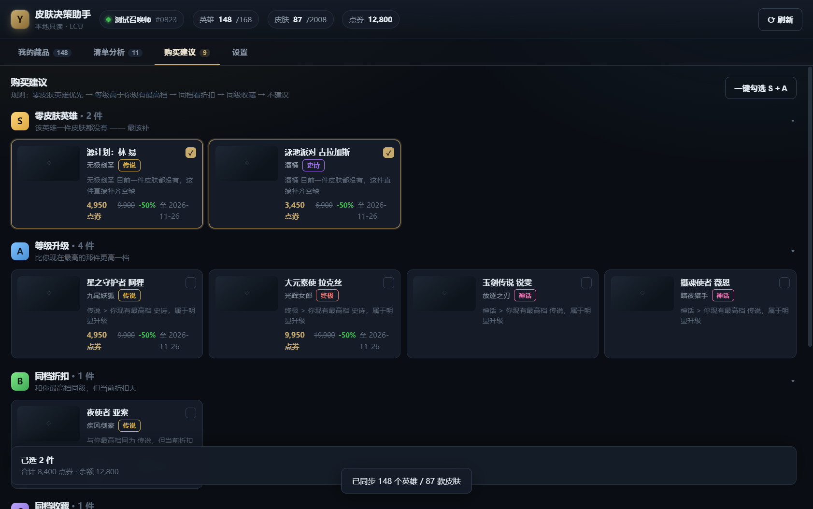
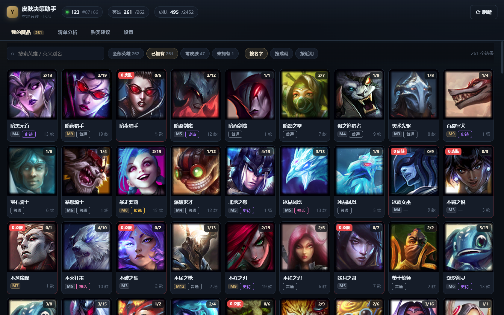

# 英雄联盟 · 皮肤购买决策助手

本地桌面工具。读取你客户端里的**藏品、成就、商城价格、战利品**，把「我该先买哪款皮肤」变成一张可比较的清单。

不注入、不改客户端文件、不代付。全部数据来自本机 LCU 的只读接口，以及几个公开数据源。

> **非官方工具**：与 Riot Games、腾讯及英雄联盟客户端团队无关。LCU 不是公开接口，客户端更新后可能失效；使用风险自负。



---

## 下载与启动

**下载**：`release/LOL皮肤决策助手-0.1.0-x64.zip`（开源仓库发布后，从 GitHub Releases 下载同名文件）。

解压后双击 `LOL皮肤决策助手.exe`，**不需要安装**。

1. 解压到桌面或 D 盘等**非系统目录**，不要放进 `Program Files`。
2. 先启动英雄联盟客户端并登录到大厅。
3. 双击 `LOL皮肤决策助手.exe`；弹出 UAC 时点「是」。
4. 顶部出现召唤师名、英雄数和皮肤数即连接成功；未连接就点右上角刷新。
5. 卸载：直接删除整个文件夹；方案和缓存在 `userdata/`，拷走文件夹即可换电脑。

- 如果 Windows 弹出 SmartScreen「已保护你的电脑」：点「更多信息」→「仍要运行」。程序没有买代码签名证书，不是病毒。
- 方案、缓存都在解压目录的 `userdata/` 里，整个文件夹可以拷走（换电脑、U 盘都行）。

### 系统要求

- Windows 10 / 11 x64
- 英雄联盟国服客户端，已登录到大厅
- 不需要安装 Node.js / Python

### 启动顺序

1. 先启动英雄联盟（从 WeGame 或桌面快捷方式，不要直接点 `LeagueClient.exe`）
2. 登录账号，停在大厅（选人、对局中也可以）
3. 再打开本工具；如果显示未连接，点右上角刷新

客户端重启后端口会变，点一次刷新即可重新探测。

<details>
<summary>为什么必须管理员权限（国服）</summary>

国服 `TCLS / WeGame` 的 `lockfile` 经常是 0 字节，凭据只写在 `LeagueClientUx.exe` 的启动参数里，普通权限读不到命令行。实测：

```
C:\WeGameApps\英雄联盟\LeagueClient\lockfile   → 0 字节
LeagueClientUx.exe 进程命令行                    → 需要管理员
LCU 端口 5914                                    → 通，但 401
```

打包版通过 `requestedExecutionLevel: "requireAdministrator"` 把提权声明写进 manifest，双击即管理员，没有黑框。开发态请在管理员终端里跑 `npm run dev`。

</details>

---

## 三个界面

### 1. 总览

- **藏品概览**：皮肤完成度圆环、8 档稀有度进度、零皮肤英雄、无史诗及以上、无传说及以上。
- **常玩英雄**：按成就分取前 6 个英雄，每个英雄 5×2 皮肤小卡（已拥有优先，未拥有补满，有活动优先）。
- **决策输入**：粘贴皮肤名清单，或直接粘贴方案口令，进入比较流程。

### 2. 皮肤

左侧多组筛选，右侧卡片列表：

- 搜索、方案、快速视图（全部/限时打折/限时销售）、商城视图（神话商店/精品推荐/限定/最新上市）
- 拥有状态、获取方式、活动折扣
- 英雄（常玩/零皮肤/全部、头像多选、定位、梯度、成就段）
- 皮肤系列、稀有度、上线年份、炫彩/臻彩
- 排序：推荐值 / 时间 / 品质 / 英雄（定位）/ 英雄（成就）/ 系列

点卡片打开同英雄皮肤浮层；点右下推荐值看八项明细；点「特效演示」跳 B 站搜索。

### 3. 方案

- 做一次比较会自动生成方案，只存**皮肤 ID、名称、到期日、预算**，价格和拥有状态在打开时用当前会话快照关联。
- 支持改名、改到期、删除、分享口令、导入口令、查看推荐值明细、跳到皮肤列表按方案筛选。

### 其他

- **设置抽屉**：连接状态、商城价格探测、皮肤元数据来源与缓存、只读说明。
- **比较结果**：按推荐值从高到低排列，逐项对比稀有度、售价、限定、炫彩/臻彩、英雄皮肤数、荣耀等级、英雄强度。



> 截图可能落后于当前版本，以实际界面为准。

---

## 数据从哪来

| 数据 | 来源 | 实测 / 说明 |
|---|---|---|
| 拥有的英雄/皮肤 | `GET /lol-champions/v1/inventories/{summonerId}/champions` | 原始返回 262 英雄 / 2452 皮肤；过滤经典模式后 **173 英雄 / 1967 皮肤** |
| 皮肤等级/中文名/系列/绝版 | `GET /lol-game-data/assets/v1/skins.json` | 随客户端离线可用；缓存 6 小时 |
| 英雄称号/别名 | `GET /lol-game-data/assets/v1/champion-summary.json` | 随客户端语言 |
| 英雄成就 | `GET /lol-champion-mastery/v1/local-player/champion-mastery` | 判断「常玩英雄」的主依据；缓存 90 秒 |
| 钱包 | `GET /lol-inventory/v1/wallet/IP` | 裸调 400，带币种子路径可拿全部币种 |
| 战利品 | `GET /lol-loot/v1/player-loot` | 区分碎片与永久；缓存 60 秒 |
| 商城皮肤页 | `GET /lol-store/v1/skins` + `/featured` | 价格、折扣、限时、精品；缓存 5 分钟 |
| 全量商城目录 | `GET /lol-store/v1/catalog` | 比较流程取价；不要带 `?inventoryType=` |
| 限时折扣 | `GET /lol-store/v1/catalog/sales` | 有区服可能为空 |
| 神话商店 | `https://itemshop.gg/api/v1/shop/league-of-legends` | LCU 不提供；第三方数据，缓存 30 分钟 |
| 英雄梯度 | `https://lol-api-champion.op.gg` | global 排位/大乱斗；缓存 1 小时 |
| 上线时间 | `data/skin-release.json`（Meraki Analytics） | 缺失时启动后台用 B 站演示视频日期补全 |
| 人气 | `data/popular-skins.json`（lolskins.io） | 仅作排序参考 |
| 臻彩 | `splash.buguoguo.cn` → `data/prestige-chromas.json` | 12 小时检查一次 |
| 国服活动折扣 | `data/act-sale.json`（腾讯活动页解析） | 神话半价等；缺失时回退人工文件 |

### 哪些是本地文件，哪些要联网

- **离线可用**：藏品、成就、静态皮肤库、方案、已下载的静态数据。
- **需要联网**：神话商店、OP.GG 梯度、B 站上线时间补全、臻彩清单更新。失败时都会降级或保留旧数据，不影响主流程。
- **价格可能不可用**：部分国服区服的 `/lol-store/*` 由运营后端接管，返回空是正常现象；关掉价格模块即可。

### 数据存在哪

默认在解压目录的 `userdata/`：

| 文件 | 内容 |
|---|---|
| `plans.json` | 方案（只存皮肤 ID、名称、到期、预算） |
| `cache/skins.json` | 编译后的皮肤/英雄静态目录（6 小时过期） |
| `relaunch.log` | 提权重启排障日志 |
| Chromium 缓存 | `lcu://` 皮肤图片缓存，可安全删除 |

---

## 推荐值

每款皮肤按八项求和：

| 项 | 规则 |
|---|---|
| 稀有度 | 普通 2 / 稀有 6 / 史诗 10 / 传说 18 / 终极 30 / 神话 100 / 卓越 300 / 圣堂 1000；减去该英雄所有已拥有皮肤各自档位 × 50% |
| 售价 | 原价 ÷ 100 |
| 限定 | +20 |
| 臻彩 | 每个 +100 |
| 炫彩 | 每个 +10 |
| 零皮肤 | 该英雄一件皮肤都没有 +100 |
| 荣耀 | 1–5 级 ×1，6–10 ×2，11–20 ×3，21–30 ×4，31+ ×5 |
| 新鲜度 | ≤2015 = 5；2016–2020 = 10；2021 起 15 + (年−2021) × 5 |

完整口径（含互斥、筛选、数据关联）见 [docs/SPEC.md](docs/SPEC.md)。

---

## 分享口令

```
【2026-11-20 方案1】口令 咕咕rB68AAsIDrQE嘎嘎
```

- 编码：皮肤 ID → 全量皮肤索引 → delta → varint → DEFLATE → Base64url。
- 解析：有 `咕咕…嘎嘎` 就精确解码，失败明确报错；没有才走皮肤名模糊匹配。
- **依赖全量皮肤总数**：客户端大版本更新导致总数变化时，旧口令会提示「索引已错位，无法还原」，不会静默导入错误皮肤。

---

## 常见问题

**Q：顶栏一直显示「客户端未连接」？**
先确认客户端已登录到大厅；再点刷新。仍不行就检查是否以管理员身份运行（国服必须）。

**Q：为什么英雄数是 173，不是 262？**
客户端同一份藏品里同时下发普通英雄和经典模式（Jade）英雄，名字完全一样。工具按 `relatedPrimeItemId`、alias、ID 段等判据剔除变体并去重，得到 173 个正常英雄 / 1967 款皮肤。

**Q：价格不显示 / 商城接口探测为空？**
部分区服的 `/lol-store/*` 被运营后端接管，返回空是正常现象。设置里关掉价格模块即可，推荐逻辑不受影响。

**Q：神话商店拉取失败？**
它依赖 itemshop.gg 联网，LCU 没有这份数据；断网或接口限流时会显示失败。

**Q：方案会丢吗？**
方案写在 `userdata/plans.json`。当前是直接覆盖写，写入过程中断电可能损坏文件；损坏后应用会当空列表启动，不会崩溃。重要方案建议先分享口令备份。

**Q：换了账号，方案还在？**
方案不按账号隔离，属于本机数据；藏品缓存会按召唤师 ID 隔离，不会串号。

**Q：战利品里的皮肤算拥有吗？**
不算。碎片和永久单独显示为「有碎片 / 战利品可解锁」；`ownership.rental.rented` 的租借皮肤算已拥有。

---

## 文档

| 文档 | 内容 |
|---|---|
| [DESIGN.md](DESIGN.md) | 视觉与术语唯一权威：卡片、配色、字号、图标、口令格式、评分规则 |
| [docs/SPEC.md](docs/SPEC.md) | 七个界面 + 全局框架；模块/元素/数据源/缓存/关联/口径/互斥矩阵 |
| [docs/TEST.md](docs/TEST.md) | 按编号的逐屏黑盒用例；区分 mock 可测与必须真实客户端 |
| [docs/UNUSED.md](docs/UNUSED.md) | 未使用的接口、数据字段、文件与发布前清理项 |

测试约定：**先看界面再点，不靠读代码猜行为**。新增功能时先改 SPEC，再改代码，最后补 TEST。

---

## 开发

```powershell
npm install
npm run dev     # Vite + Electron 热更新（非提权，只能看到提权提示）
npm run build   # 构建 dist
npm run pack    # 打包便携 zip 到 release/
npm run audit   # 只读审计
```

不连客户端看界面：`http://127.0.0.1:5199/?mock=1`。
mock 数据量为 168 英雄 / 2008 皮肤，仅用于布局验证，不代表真实口径。

### CLI（给 LLM / skill 用）

```bash
node cli/lol.js status --json
node cli/lol.js collection --json [--full]
node cli/lol.js top --limit 20 --json
node cli/lol.js analyze --file list.txt --json
node cli/lol.js analyze --text "星之守护者 阿狸" --json
node cli/lol.js skin 103014 --json
node cli/lol.js plans --json
```

CLI 检测到需要管理员权限时会自动静默提权重跑。

### Agent / Skill（免安装）

把整个项目文件夹作为 Agent 的工作目录打开即可，不需要安装：

- `AGENTS.md`：通用入口；任何会读 `AGENTS.md` 的 Agent 都会被告知去读皮肤决策 skill
- `.trae/skills/lol-skin-advisor/SKILL.md`：Trae 工作区技能目录
- `.claude/skills/lol-skin-advisor/SKILL.md`：Claude Code 工作区技能目录
- `skills/lol-skin-advisor/SKILL.md`：唯一源文件，改这里后同步上面两份

前提：Windows + Node.js 18+ + 已登录客户端；所有命令在项目根目录执行。

### 构建发布版

```powershell
npm run pack
```

产物在 `release/`。如果 electron-builder 在解压 `winCodeSign` 时报“无法创建符号链接”：

1. 打开 Windows「设置 → 隐私和安全性 → 开发者选项 → 开发人员模式」，重跑；或
2. 用管理员终端重跑；或
3. 把 `winCodeSign` 里 `darwin/` 和 `linux/` 目录排除后手动解压到 electron-builder 缓存。

### 目录结构

```
core/               数据层（纯 Node，零 Electron 依赖，桌面端与 CLI 共用）
  lcu/              连接、藏品、成就、静态目录、商城、战利品、过滤
  analyzer.js       清单解析与分层推荐
  plans.js          方案存储与分享
  mythicshop.js     神话商店（itemshop.gg）
  championstats.js  英雄梯度（OP.GG）
cli/lol.js          命令行入口
electron/           桌面壳：窗口、IPC、lcu:// 资源代理、提权重启
src/                前端（只通过 preload 白名单拿数据）
data/               随包静态数据
docs/               SPEC 与 TEST
skills/             Agent Skill 源文件
.trae/skills/       Trae 工作区技能入口
.claude/skills/     Claude Code 工作区技能入口
build/icon.png      应用图标
AGENTS.md           Agent 通用入口
tools/              探针与数据生成脚本
```

---

## 已知限制

- LCU 是客户端内部接口，Riot 未承诺向后兼容；客户端大版本更新后字段可能漂移。
- 国服商城接口可能整体不可用，价格模块是可选能力。
- OP.GG 没有国服数据，梯度为 global 口径，仅供参考。
- 分组列表每个二级分组最多渲染 60 张卡片。
- 设置抽屉、删除确认、方案详情表不支持 Esc 关闭。
- 方案只存皮肤 ID，但价格来自当前会话的商城快照；客户端改价后需刷新页面或重启才能看到。
- 方案不按账号隔离；`plans.json` 非原子写。
- CLI 的方案文件默认在临时目录，与桌面端不是同一份。

---

## 致谢与许可

- 端点与字段参考 [`@hasagi/types`](https://www.npmjs.com/package/@hasagi/types)；连接发现顺序参考 [lcu-driver](https://github.com/sousa-andre/lcu-driver) / [league-link](https://github.com/qantoo/league-link)；国服提权路线与 [LeagueAkari](https://github.com/LeagueAkari/LeagueAkari) 一致。
- 神话商店数据来自 [itemshop.gg](https://itemshop.gg/league-of-legends)，展示时保留来源链接。
- 英雄梯度来自 OP.GG；上线时间来自 Meraki Analytics 与 B 站演示视频；臻彩清单来自布锅锅联盟宇宙；人气来自 lolskins.io。
- 图标使用 Feather 风格 SVG（MIT）。
- 本项目基于 [LICENSE](LICENSE) 开源。
